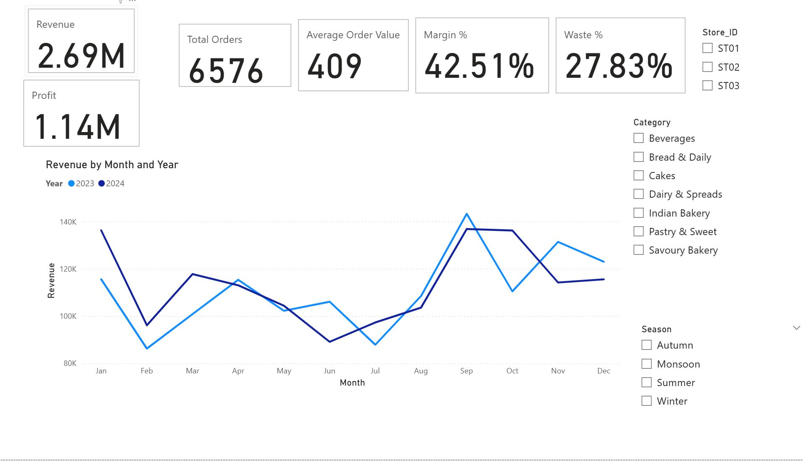
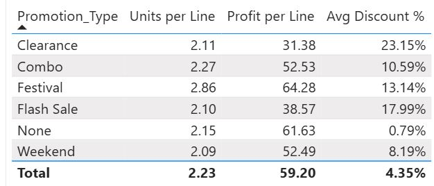

# bakery-sales-powerbi-dashboard
Interactive Power BI dashboard analysing 19,000+ bakery sales line items
(6,576 orders, 3 stores, 35 products, Jan 2023 – Dec 2024) to find where
profit is made and where it is lost to waste and discounting.

## Tools
Power BI, Power Query, DAX 

## Dashboard pages
| Page | What it shows |
|---|---|
| Overview | Revenue, profit, margin, orders, AOV, waste %, monthly trend by year |
| Products | Revenue vs margin vs profit by product; top 10 by profit |
| Time patterns | Revenue by hour and weekday; weekend vs weekday order value |
| Promotions | Units and profit per line by promotion type |
| Waste | Waste % by category, storage type and store |
| Customers | Segments, loyalty, payment methods |
| Festivals | Average line value by festival vs normal days |

## Key findings
- Revenue was 2.69M with a 42.5% margin. 2024 revenue grew 2.2% on 2023.
- Only Festival promotions increased volume (2.86 vs 2.15 units per line)
  while keeping profit per line (64 vs 62). Clearance (31) and Flash Sale (39)
  discounted heavily without selling more units.
- Cakes have the highest waste (about 39% of units produced went unsold).
  Estimated cost of unsold stock across all products is about 1.03M.
- 37% of revenue comes on Saturday and Sunday, and weekend orders are about
  7% larger. The busiest hour is 9am.
- Festival days average up to about 80% more per line than normal days
  (Diwali 233 vs 130).
- Waste is similar across the three stores (27.5–28.3%), so it is a
  product issue rather than a store issue.

## Measures
Revenue, Profit, Margin %, Total Orders, Average Order Value, Waste %,
Waste Cost, Revenue/Profit YoY % (see the .pbix for the DAX).

## Notes and limitations
- Dataset source: https://www.kaggle.com/datasets/sdcloud/historical-bakery-sales-dataset/data
- Currency is not stated in the data, so figures are shown without symbols.
- Customer ratings and loyalty status showed no relationship with spend
  or satisfaction, so they are not used for conclusions.
- Waste cost is the cost price of all unsold units, so it is an upper-bound
  estimate (unsold stock may be discounted or reused).
- Only two years of data, so seasonal patterns are indicative.

## How to open
Download `bakery_dashboard.pbix` and open it in Power BI Desktop.
